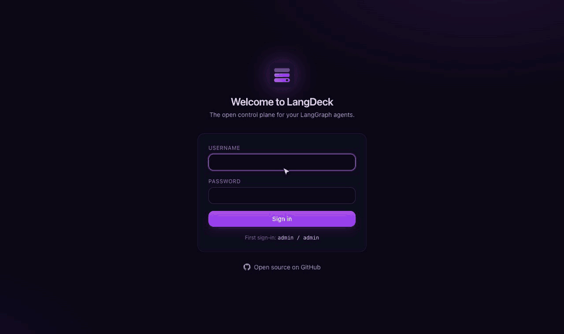
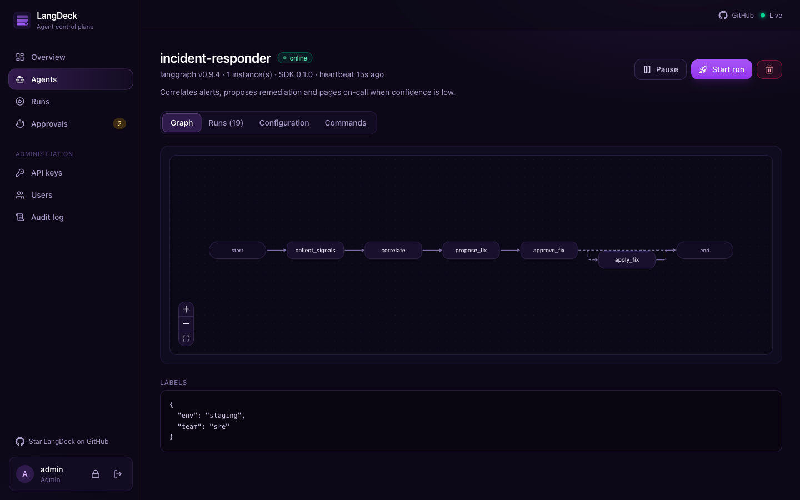
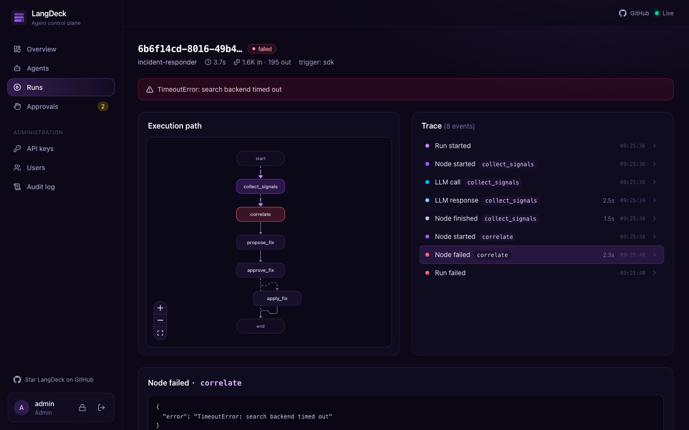
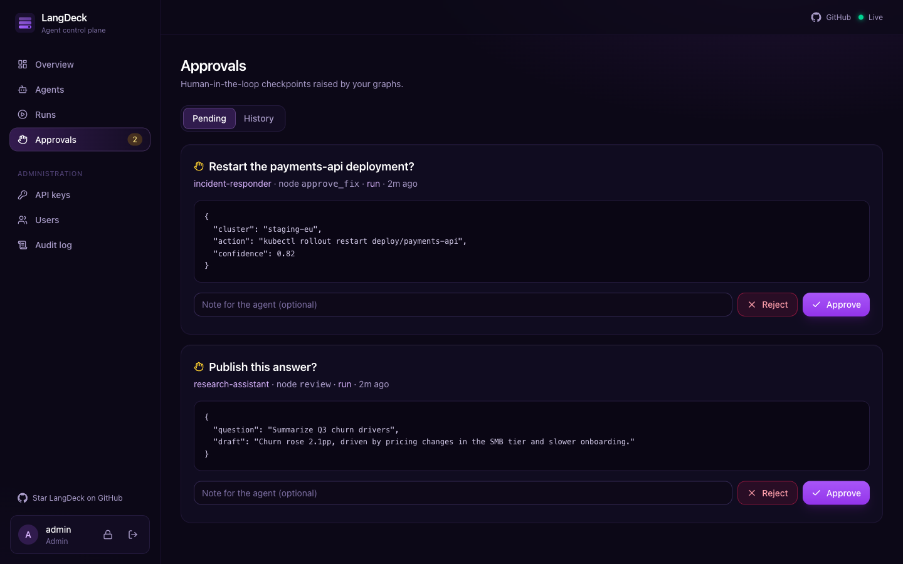
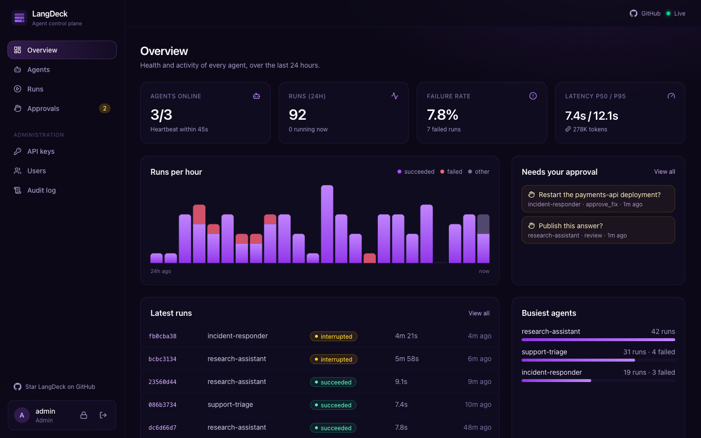
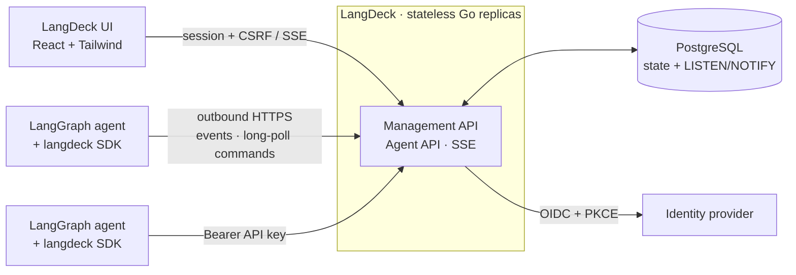

<div align="center">


# LangDeck

**The open-source control plane for LangGraph agents.**

See every run. Steer every agent. Keep a human in the loop.

**[Live demo](https://langdeck-demo.onrender.com)** · [Docker Hub](https://hub.docker.com/r/rojinebrahimi/langdeck) · [Docs](docs/architecture.md)

[](https://github.com/rojinebrahimi/langdeck/actions/workflows/ci.yml)
[](https://hub.docker.com/r/rojinebrahimi/langdeck)
[](LICENSE)
[](go.mod)
[](CLA.md)



</div>

---

LangGraph makes it easy to build agents. Running a fleet of them in production is a
different problem: *Which agents are alive? What did this run actually do? Can I stop it?
Can I change the model without a redeploy? Can someone approve this before it emails a
customer?*

LangDeck answers those questions with a self-hosted control plane: a single Go binary
with a purple React UI, PostgreSQL, and a three-line Python SDK. No vendor lock-in, no
per-seat pricing, no data leaving your network.

## Features

| | |
|---|---|
| 🛰️ **Agent registry** | Every agent registers itself with name, version, labels, instances and live heartbeat status (online / paused / offline). |
| 🕸️ **Graph visualization** | Your `StateGraph` topology is drawn automatically, including conditional edges. |
| 🔎 **Run tracing** | Node, LLM and tool steps with inputs, outputs, latency and token usage, streamed live. Replay the execution path on the graph. |
| 🎛️ **Remote control** | Start runs from the UI, cancel them mid-flight, pause or resume whole agents. |
| ⚙️ **Live configuration** | Versioned runtime config (model, prompts, thresholds...) pushed to every instance instantly, with history and rollback. |
| ✋ **Human in the loop** | `deck.request_approval(...)` pauses a node until an operator approves or rejects it in the Approvals inbox. |
| 📊 **Fleet dashboard** | Runs per hour, failure rate, p50/p95 latency, token usage, busiest agents. |
| 🔐 **Enterprise auth** | Built-in accounts (default `admin`/`admin`, forced change on first login) or OIDC SSO (Keycloak, Okta, Entra ID, Google, GitLab, Dex...) with PKCE, group-to-role mapping, RBAC, scoped and expiring API keys. |
| 🧾 **Audit log** | Every action recorded with actor, target and IP. |
| 🚀 **Production-ready** | Stateless replicas, Postgres LISTEN/NOTIFY fan-out, Prometheus metrics, retention, Helm chart, signed multi-arch images. |
| 🧱 **Agent-friendly networking** | Agents only make outbound HTTPS calls. No inbound ports, works behind NAT and firewalls. |
| 🛡️ **Never in the way** | The SDK buffers in the background; if LangDeck is down, your agents keep running. |

<table>
  <tr>
    <td></td>
    <td></td>
  </tr>
  <tr>
    <td align="center"><sub>Agent topology, config and controls</sub></td>
    <td align="center"><sub>Run trace with the execution path highlighted</sub></td>
  </tr>
  <tr>
    <td></td>
    <td></td>
  </tr>
  <tr>
    <td align="center"><sub>Human-in-the-loop approvals</sub></td>
    <td align="center"><sub>Fleet health over the last 24 hours</sub></td>
  </tr>
</table>

## Quick start

### 1. Try it in one command

```bash
git clone https://github.com/rojinebrahimi/langdeck && cd langdeck
docker compose up --build
```

Open **http://localhost:8080** and sign in as **`admin` / `admin`** (you will be asked to
choose a new password right away). Then watch the bundled demo agent stream runs. Start a run from its page and approve it under **Approvals**.

### 2. Connect your own agent

```bash
pip install langdeck
export LANGDECK_URL=http://localhost:8080
export LANGDECK_API_KEY=ldk_...      # Settings → API keys → New key (role: agent)
```

```python
from langdeck import LangDeck

deck = LangDeck(name="support-bot", version="1.0.0")
app = deck.instrument(builder.compile())    # your existing StateGraph
deck.start()

app.invoke({"messages": [("user", "Where is my order?")]})
```

Read live config, ask for approval, and let the UI start runs:

```python
def answer(state):
    model = deck.config.get("model", "gpt-4o-mini")          # pushed from the UI
    if state["amount"] > 100 and not deck.request_approval("Refund > $100?", state):
        return {"reply": "A teammate will follow up."}
    ...

app = deck.instrument(graph, input_mapper=lambda ui_input: {"question": ui_input["question"]})
```

More in the [SDK guide](sdk/python/README.md).

### 3. Deploy to Kubernetes

```bash
helm install langdeck oci://registry-1.docker.io/rojinebrahimi/langdeck \
  --set publicURL=https://langdeck.example.com \
  --set auth.oidc.issuer=https://sso.example.com/realms/main \
  --set auth.oidc.adminGroups=platform \
  --set existingSecret=langdeck-secrets \
  --set ingress.enabled=true
```

The secret holds `database-url` and `oidc-client-secret`. See the
[chart values](deploy/helm/langdeck/values.yaml) and the [production checklist](docs/security.md#production-checklist).

### Other ways to run

```bash
docker run -p 8080:8080 rojinebrahimi/langdeck:latest          # in-memory, admin / admin
make build && ./bin/langdeck serve                             # single static binary
```

Prefer to look before you install? **[langdeck-demo.onrender.com](https://langdeck-demo.onrender.com)**
runs the demo agent on a free instance (sign in with any email; may take ~30 s to wake up).
It is demo-only — dev sign-in, no persistence — so don't put real data there.
(Its blueprint lives in [`render.yaml`](render.yaml) if you want a throwaway instance.)

## Architecture



- **Pull-based control channel:** agents long-poll for commands, so they never expose a port.
- **Stateless servers:** scale horizontally; Postgres `LISTEN/NOTIFY` keeps every replica's live view in sync.
- **One binary:** the UI is embedded with `go:embed`; no Node.js in production.
- **At-least-once commands** with de-duplication, expiry and `SKIP LOCKED` claims.

Deep dive: [docs/architecture.md](docs/architecture.md).

## Security

LangDeck can reconfigure production agents, so security is a first-class feature:

- Built-in accounts with PBKDF2 hashing; the default `admin` / `admin` must be changed before anything else works
- OIDC Authorization Code + PKCE, `state` and `nonce`; group claims mapped to roles
- Server-enforced RBAC: **viewer** (read), **operator** (run, cancel, pause, configure, approve), **admin** (keys, users, audit, delete)
- Sessions and API keys stored only as SHA-256 hashes; `__Host-` `HttpOnly` `Secure` `SameSite` cookies
- CSRF synchronizer tokens, strict CSP, HSTS, clickjacking protection
- Agent keys restricted to the agent API, optionally bound to one agent, expiring and instantly revocable
- Rate limiting, body-size limits, payload caps, secret redaction in the SDK
- Distroless non-root image, read-only filesystem, cosign-signed with SBOM and provenance

Full threat model and hardening guide: [docs/security.md](docs/security.md). Report vulnerabilities via [SECURITY.md](SECURITY.md).

## Documentation

| | |
|---|---|
| [Architecture](docs/architecture.md) | Components, data model, flows, delivery guarantees, scaling |
| [Configuration](docs/configuration.md) | Every environment variable |
| [HTTP API](docs/api.md) | Management and agent endpoints |
| [Security](docs/security.md) | Threat model, OIDC setup, production checklist |
| [Python SDK](sdk/python/README.md) | Instrumenting LangGraph agents |

## Project layout

```
cmd/langdeck        server entrypoint
internal/           api · auth · store (memory, postgres) · events · server · jobs
web/                React + TypeScript + Tailwind UI (embedded in the binary)
sdk/python          langdeck Python SDK
examples/           runnable demo agent
deploy/helm         Helm chart
docs/               architecture, security, configuration, API
```

## Development

```bash
make dev        # API + UI with hot reload (http://localhost:5173)
make test       # Go (race) + UI + SDK tests
make build      # ./bin/langdeck with the UI embedded
make docker     # container image
```

Tests cover the storage contract (run against both the in-memory store and real PostgreSQL),
the full HTTP API including RBAC and CSRF, the UI, and the SDK against a real LangGraph
graph. CI also runs an end-to-end test with the real server, a Trivy image scan, CodeQL,
`govulncheck` and Helm manifest validation.

## Roadmap

- [ ] Resume native LangGraph `interrupt()` checkpoints from the UI
- [ ] Replay a run from a checkpoint with edited state
- [ ] Cost tracking, budgets and alerting
- [ ] OpenTelemetry trace export
- [ ] TypeScript SDK for LangGraph.js
- [ ] Gradual config rollouts (canary by percentage)

## Contributing

Contributions are welcome! Read the [contributing guide](CONTRIBUTING.md) to get set up.
First-time contributors sign our [CLA](CLA.md) once by commenting on their pull request;
the CLA bot walks you through it.

## License

LangDeck is licensed under the [Apache License 2.0](LICENSE).
