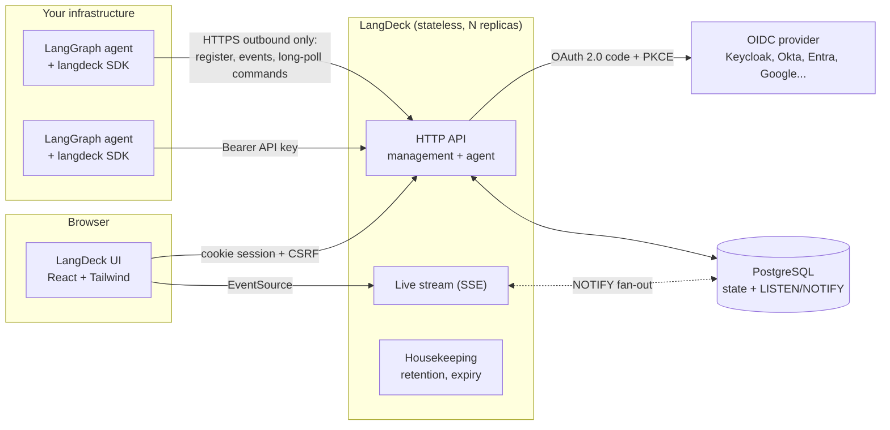
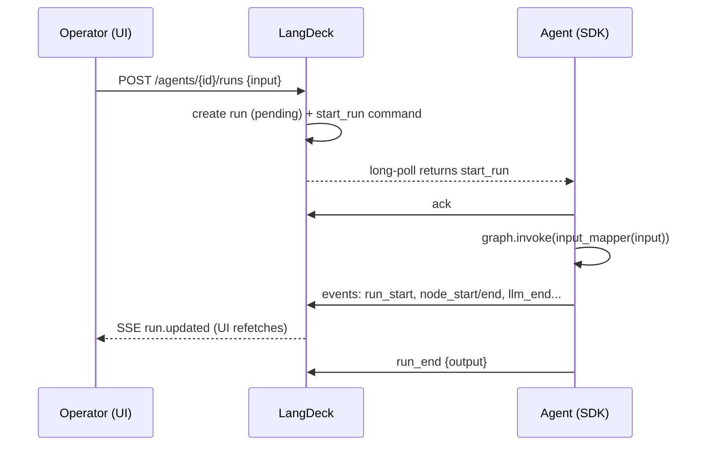

# Architecture

LangDeck is a **control plane** for LangGraph agents. Your agents keep running wherever
they run today (Kubernetes, VMs, serverless workers, a laptop); LangDeck observes them,
and lets people steer them, through one small SDK.

## Design principles

1. **Agents dial out; LangDeck never dials in.** The SDK talks to LangDeck over outbound
   HTTPS only. Commands (start, cancel, pause, new config) are fetched with a long-poll.
   Agents can live behind NAT, firewalls or service meshes without opening ports, and a
   compromised control plane cannot reach into agent networks.
2. **The agent never waits on LangDeck.** Events are buffered in memory and shipped by a
   background thread. If LangDeck is down, graphs keep running; the buffer retries with
   backoff and drops the oldest events past a bound. Registration retries in the background.
3. **Stateless servers, Postgres as the source of truth.** Any replica can serve any
   request. `LISTEN/NOTIFY` fans change notifications out across replicas so the live UI and
   long-polls react within milliseconds; a 2-second re-check makes a lost notification a
   latency issue, never a correctness issue.
4. **Notifications carry ids, not data.** Clients refetch through the normal, authorized
   API. This keeps the stream tiny and avoids a second authorization path.
5. **One binary.** The UI is compiled and embedded with `go:embed`. There is no Node
   runtime in production and nothing else to deploy.

## Components

| Component | Responsibility |
|---|---|
| `internal/api` | Management API (humans and automation), agent API (SDKs), SSE stream |
| `internal/auth` | OIDC Authorization Code + PKCE, server-side sessions, API keys, CSRF, role mapping |
| `internal/store` | Storage contract with two implementations and a shared contract test suite |
| `internal/events` | Change notifications: in-process or Postgres `LISTEN/NOTIFY` |
| `internal/jobs` | Retention purge, session cleanup, command expiry (idempotent, safe on every replica) |
| `internal/server` | Security headers, rate limiting, request ids, Prometheus metrics, panic recovery |
| `web/` | The UI, embedded at build time |
| `sdk/python` | LangGraph tracing via LangChain callbacks, command loop, approvals, config |

## Data model

| Entity | Notes |
|---|---|
| `agents` | One row per agent name. Graph topology, labels, declared accesses and dependencies, version, desired state, last heartbeat. Status (online/offline/paused) is derived, never stored. |
| `agent_configs` | Append-only versions of runtime configuration. The newest version wins on every instance. |
| `runs` | One graph execution. SDK-generated or UI-generated id, status, input/output, token counts. |
| `run_events` | The trace: node, LLM and tool steps with latency and (redacted, size-capped) payloads. |
| `commands` | Queue of instructions per agent: `pending → delivered → acked/failed/expired`. |
| `interrupts` | Human-in-the-loop requests and their decisions. |
| `users`, `sessions`, `api_keys` | Identity. Sessions and keys are stored as SHA-256 hashes only. |
| `audit_log` | Append-only record of every change: who, what, when, from where. |

## Key flows

### Run started from the UI

### Human approval

A node calls `deck.request_approval(question, payload)`. The SDK flushes the trace, creates
an interrupt and long-polls for the decision; the run shows as `interrupted` and the
question appears under **Approvals**. When an operator approves or rejects, the waiting
long-poll wakes immediately (via `NOTIFY`) and the node continues with a `Decision`.

### Cancellation

Pending runs are cancelled immediately on the server. Running runs get a `cancel_run`
command; the SDK raises `RunCancelled` at the next node boundary (or while waiting for an
approval) and reports `run_error {cancelled: true}`. Cancellation is cooperative by design:
killing a node mid-flight could leave external side effects half-done.

### Delivery guarantees

Commands are delivered **at least once**: a command delivered but not acknowledged within
two minutes is handed out again, and the SDK de-duplicates by command id. Commands not
picked up within `LANGDECK_COMMAND_TTL` (default 1h) expire, so a long-offline agent does
not wake up to a backlog of stale actions. Claims use `FOR UPDATE SKIP LOCKED`, so
replicas never hand the same command out twice concurrently.

## Scaling

- The API is stateless; scale horizontally behind any load balancer (the Helm chart ships
  an HPA and PDB).
- Each open long-poll or SSE stream holds one goroutine and no database connection while
  idle, so thousands of agents per replica are realistic.
- Event ingestion is batched (up to 500 events per request, one transaction per run).
- Retention (`LANGDECK_RETENTION_DAYS`) bounds table growth; the indexes are designed for
  "newest first" listing.

## Roadmap

- Native LangGraph `interrupt()` / checkpointer resume from the UI
- Replay a run from a checkpoint with edited state
- Cost tracking per model, budgets and alerts
- OpenTelemetry export of traces
- TypeScript SDK for LangGraph.js
- Prompt and config A/B rollouts by percentage
