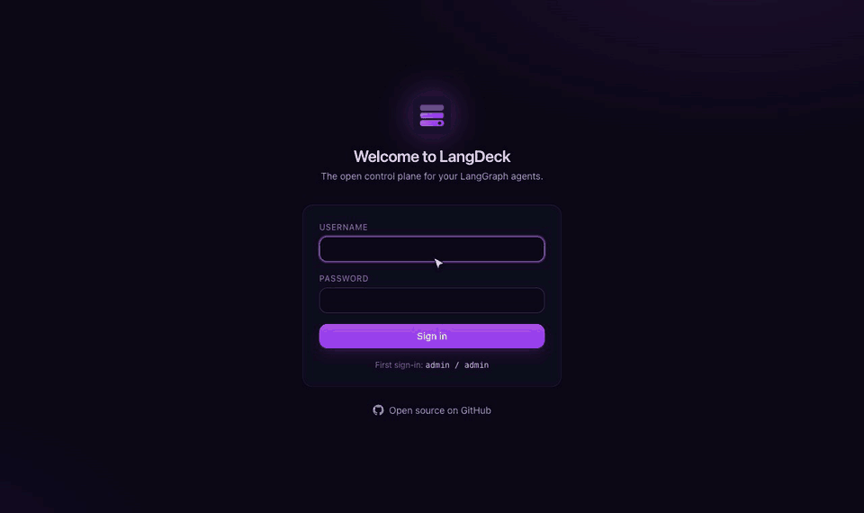

# LangDeck

**The open-source control plane for LangGraph agents.** See every run, steer every agent, keep a human in the loop.

- **GitHub:** https://github.com/rojinebrahimi/langdeck
- **Live demo:** https://langdeck-demo.onrender.com (sign in with any email; the free instance may take ~30 s to wake up)
- **Docs:** [Architecture](https://github.com/rojinebrahimi/langdeck/blob/main/docs/architecture.md) · [User guide](https://github.com/rojinebrahimi/langdeck/blob/main/docs/user-guide.md) · [Configuration](https://github.com/rojinebrahimi/langdeck/blob/main/docs/configuration.md) · [Security](https://github.com/rojinebrahimi/langdeck/blob/main/docs/security.md)



## Quick start

```bash
docker run -p 8080:8080 rojinebrahimi/langdeck:latest
```

`latest` is the newest release; `edge` tracks `main`.

Open http://localhost:8080 and sign in as `admin` / `admin`. You will be asked to choose a new password right away. With no database configured, data lives in memory.

With PostgreSQL:

```bash
docker run -p 8080:8080 \
  -e LANGDECK_DATABASE_URL=postgres://langdeck:secret@db:5432/langdeck \
  -e LANGDECK_PUBLIC_URL=https://langdeck.example.com \
  -e LANGDECK_ENV=production \
  rojinebrahimi/langdeck:latest
```

Connect an agent with the Python SDK:

```python
from langdeck import LangDeck

deck = LangDeck(name="support-bot")          # LANGDECK_URL / LANGDECK_API_KEY
app = deck.instrument(builder.compile())     # your existing StateGraph
deck.start()
```

## Features

- **Agent registry** with live heartbeat status and auto-drawn graph topology
- **Run tracing**: nodes, LLM and tool calls, latency and tokens, streamed live
- **Remote control**: start, cancel, pause and resume from the UI
- **Live configuration**: versioned, pushed to every instance, with rollback
- **Human in the loop**: `deck.request_approval(...)` plus an Approvals inbox
- **Chat notifications** to Slack, Mattermost, Microsoft Teams and Telegram
- **Enterprise auth**: built-in accounts or OIDC SSO with PKCE, RBAC, scoped API keys, audit log
- **Production-ready**: stateless replicas, Postgres LISTEN/NOTIFY, Prometheus metrics, Helm chart

## Tags

| Tag | Meaning |
|---|---|
| `latest` | Latest release |
| `X.Y.Z`, `X.Y` | Release versions |
| `edge` | Latest build of `main` |
| `sha-<commit>` | A specific commit |

Images are multi-arch (`linux/amd64`, `linux/arm64`), distroless and non-root. They are signed with cosign (keyless) and ship with SBOM and provenance attestations.

## Ports

| Port | Purpose |
|---|---|
| `8080` | UI, management API, agent API |
| `9090` | Prometheus `/metrics` (keep it off your public ingress) |

## License

Apache License 2.0. Contributions are welcome; see the [contributing guide](https://github.com/rojinebrahimi/langdeck/blob/main/CONTRIBUTING.md).
